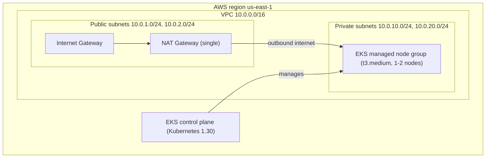

# AWS EKS Cluster with Terraform


Terraform code that provisions an **Amazon EKS** cluster and its own **VPC** in `us-east-1`, using the official
[`terraform-aws-modules/vpc`](https://registry.terraform.io/modules/terraform-aws-modules/vpc/aws) and
[`terraform-aws-modules/eks`](https://registry.terraform.io/modules/terraform-aws-modules/eks/aws) modules.

## Architecture



## What it creates

| Component | Details |
|-----------|---------|
| VPC | `10.0.0.0/16` across 2 availability zones (`us-east-1a`, `us-east-1b`) |
| Subnets | 2 public and 2 private subnets |
| NAT | One shared NAT Gateway so private nodes can reach the internet |
| EKS cluster | `devops-portfolio-eks`, Kubernetes 1.30, public API endpoint |
| Node group | EKS managed, Amazon Linux 2023, `t3.medium`, min 1 / desired 1 / max 2 |
| Access | The identity that runs `terraform apply` is granted cluster admin via an EKS access entry |

## Project structure

```text
.
├── providers.tf   # Terraform and AWS provider versions, region
├── main.tf        # VPC and EKS modules
├── outputs.tf     # Cluster name, endpoint, VPC ID, kubectl command
└── .gitignore     # Keeps state, .terraform/ and *.tfvars out of git
```

## Prerequisites

- An AWS account and the [AWS CLI](https://aws.amazon.com/cli/) configured with credentials that can create VPC, EKS and IAM resources
- [Terraform](https://developer.hashicorp.com/terraform/install) 1.5 or newer
- [kubectl](https://kubernetes.io/docs/tasks/tools/)

## Usage

```bash
git clone https://github.com/wahablabs/terraform-aws-eks-pipeline.git
cd terraform-aws-eks-pipeline

terraform init
terraform plan
terraform apply
```

Creating the cluster takes roughly 15 minutes. Then connect kubectl (the exact command is also printed as the `configure_kubectl` output):

```bash
aws eks update-kubeconfig --region us-east-1 --name devops-portfolio-eks
kubectl get nodes
```

## Outputs

| Name | Description |
|------|-------------|
| `cluster_name` | Name of the EKS cluster |
| `cluster_endpoint` | Kubernetes API server endpoint |
| `vpc_id` | ID of the created VPC |
| `configure_kubectl` | Command to configure kubectl for the cluster |

## Cost and clean-up

This stack creates billable resources (EKS control plane, EC2 node, NAT Gateway). Destroy it when you are done:

```bash
terraform destroy
```

## Notes

- State is stored locally. For team use, add a remote backend such as S3 with DynamoDB locking.
- The API endpoint is public for convenience. Restrict it with `cluster_endpoint_public_access_cidrs` for real workloads.

## Author

**Abdul Wahab** - [GitHub @wahablabs](https://github.com/wahablabs) · [Upwork](https://www.upwork.com/freelancers/~01070211c5bbfca5e8)

## License

[MIT](LICENSE)
